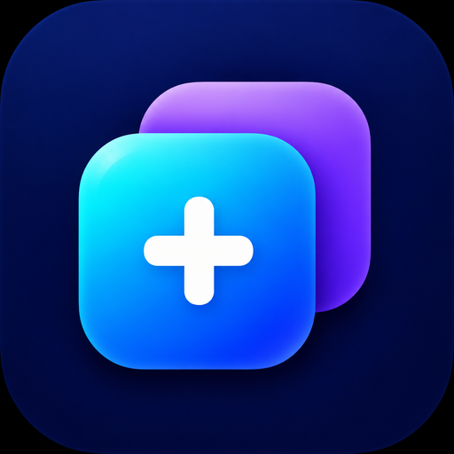

<p align="center"></p>

# ClonApps

Aplikasi Android native (Kotlin + Jetpack Compose) untuk memilih aplikasi yang sudah terpasang lalu
menjalankan **salinannya dengan akun dan data terpisah**, memakai **profil kerja Android (Work Profile)**
sebagai fondasi — tanpa root, tanpa API tersembunyi, tanpa mengubah package name atau menandatangani ulang APK.

> **Status jujur:** kode lengkap dan unit test modul inti lulus. APK debug dibangun oleh GitHub Actions.
> Belum ada pengujian di perangkat fisik (termasuk Xiaomi Pad 6) maupun pada aplikasi populer.
> ClonApps **tidak** menjanjikan semua aplikasi berhasil. Lihat [docs/TESTING.md](docs/TESTING.md) dan
> [docs/LIMITATIONS.md](docs/LIMITATIONS.md).

## Cara kerja singkat

```
Profil utama (user 0)                         Profil kerja (dibuat ClonApps, mis. user 10)
┌───────────────────────────┐   intent bertanda tangan   ┌────────────────────────────────────┐
│ ClonApps (UI, antrean,    │ ─────────────────────────▶ │ ClonApps = profile owner (DPC)     │
│ pemeriksaan, diagnostik)  │  cross-profile intent      │  • enableSystemApp / PackageInstaller│
│                           │  filter + permission       │  • konfirmasi instalasi oleh Android│
│ LauncherApps.startMain-   │  signature + HMAC          │  • verifikasi paket, uninstall      │
│ Activity(…, user 10) ─────┼──────────────────────────▶ │ Aplikasi clone (paket & tanda       │
└───────────────────────────┘   peluncuran di profil     │ tangan asli, data terpisah)         │
                                                         └────────────────────────────────────┘
```

1. **Buat profil kerja** lewat layar provisioning resmi Android (`ACTION_PROVISION_MANAGED_PROFILE`). Persetujuan pengguna sepenuhnya oleh sistem.
2. **Pilih aplikasi** (cari, filter, urutkan, pilih banyak) → **periksa persyaratan per aplikasi** → ringkasan.
3. **Antrean persisten** memproses satu per satu. ClonApps di profil kerja memasang base APK + split APK asli
   melalui session `PackageInstaller`; Android selalu meminta konfirmasi (profil non-affiliated).
4. **Verifikasi** paket ada di profil, lalu **buka** clone di profil yang benar via `LauncherApps`.
5. Status instalasi dan status peluncuran disimpan terpisah; "terverifikasi berjalan" hanya dari konfirmasi pengguna.

## Fitur

- Beranda/dashboard clone, Pilih Aplikasi, Detail Clone, Aktivitas (antrean + riwayat), Diagnostik, Pengaturan.
- Tablet: navigation rail + dua panel; ponsel: bottom navigation. Mode terang/gelap/ikuti sistem; warna dari logo.
- Bahasa Indonesia (utama) + struktur lokalisasi bahasa Inggris (`values-en`).
- Shortcut launcher, label tampilan khusus (hanya di ClonApps), favorit, hapus clone (hanya salinan di profil).
- Jeda profil (diberi label "Jeda profil" — berlaku seluruh profil), kunci tampilan ClonApps, kunci profil kerja.
- Hapus seluruh profil dengan konfirmasi terpisah yang menjelaskan data yang hilang.
- Ekspor/impor pengaturan ClonApps (tanpa data privat aplikasi lain).
- Diagnostik: deteksi Android/ROM/ABI/fitur nyata, kemampuan backend, pemeriksaan integrasi di dalam profil,
  laporan tersensor, matriks uji CSV, panduan log ADB.

## Unduh & pasang

APK debug ada di artefak GitHub Actions setiap commit (`ClonApps-v<versi>-debug-<commit>.apk` + `SHA256SUMS.txt` +
`BUILD-INFO.txt`). Ini **APK debug**, bukan rilis produksi. Panduan: [docs/INSTALL.md](docs/INSTALL.md).

## Build lokal

Butuh JDK 17+ dan Android SDK (platform API 37.1).

```bash
./gradlew :core:test :app:testDebugUnitTest   # unit test
./gradlew :app:assembleDebug                  # APK debug
./gradlew :app:lintDebug                      # lint
```

String UI dibangkitkan dari `tools/gen_strings.py` (ID + EN), yang juga memastikan setiap nilai enum punya teks.

## Struktur

| Modul / paket | Isi |
|---|---|
| `core/` | Kotlin murni: antrean & transisi status, validasi paket, pemeriksaan pra-instalasi, pemetaan kesalahan, JSON, otorisasi HMAC, sensor laporan |
| `app/…/admin` | Komponen DPC: `DeviceAdminReceiver`, GET_PROVISIONING_MODE, ADMIN_POLICY_COMPLIANCE, PROVISIONING_SUCCESSFUL |
| `app/…/profile` | Sisi profil kerja: penyiapan, penerima perintah, operasi instalasi/uninstall/peluncuran |
| `app/…/platform` | Penemuan aplikasi, deteksi perangkat, keadaan profil, peluncur, shortcut |
| `app/…/data` | Penyimpanan lokal atomik (antrean, catatan clone, riwayat, kunci pemasangan) |
| `app/…/domain` | Koordinator antrean, kanal perintah, pemetaan kegagalan, laporan diagnostik |
| `app/…/ui` | Compose: tema, komponen, enam layar, tata letak adaptif |
| `fixture/` | Aplikasi uji milik sendiri: data per profil, native library, split APK, notifikasi, file, kamera, tautan, job |

Dokumentasi: [ARCHITECTURE](docs/ARCHITECTURE.md) · [BACKENDS](docs/BACKENDS.md) · [LIMITATIONS](docs/LIMITATIONS.md) · [INSTALL](docs/INSTALL.md) · [TESTING](docs/TESTING.md)
